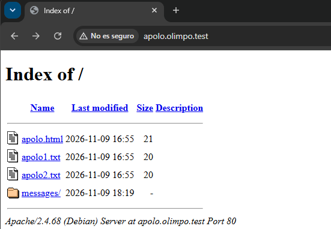
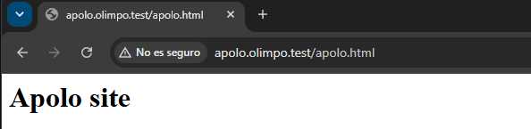
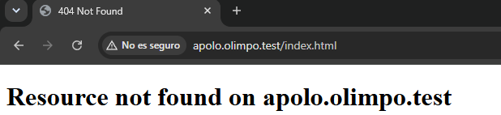
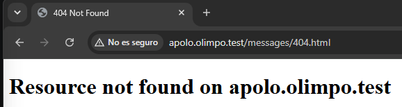
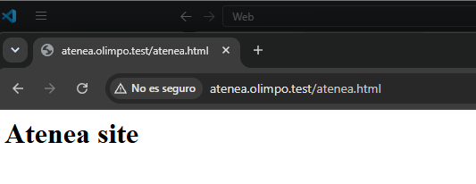
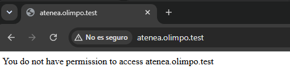
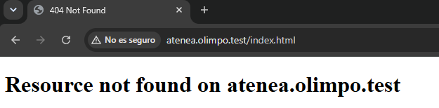
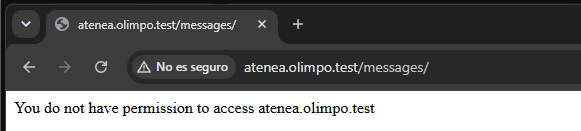

# Pruebas  Virtual websites


## 1.Añadir alias de apolo y atenea
Añadimos el alias de apolo en el fichero olimpo.test.dns. Alfinal del archivo se añadiria.

```
apolo     IN    CNAME    mercurio.olimpo.test.
atenea    IN    CNAME    mercurio.olimpo.test.

```

## 2. Añadir comprobacion zonas
Dentro del dns provision añadimos antes del reinicio `named-checkconf -z` esto hara una comprobacion de la configuracion de Bind9 y de que sus zonas DNS puedan cargarse.

```
cp -v /vagrant/files/ns1.olimpo.test/named /etc/default/
cp -v /vagrant/files/ns1.olimpo.test/named.conf.options /etc/bind
cp -v /vagrant/files/ns1.olimpo.test/named.conf.local /etc/bind
cp -v /vagrant/files/ns1.olimpo.test/olimpo.test.dns /var/lib/bind
cp -v /vagrant/files/ns1.olimpo.test/192.168.57.dns /var/lib/bind

systemctl restart named
systemctl status named

```
## 3. Configuracion resolv.conf
Aqui modificamos los resolv.conf de ns1.olimpo.dns y de mercurio.olimpo.test y le añadimos lo siguiente:

```
search olimpo.test
nameserver 192.168.57.10

```

## 4. Apache provision
En la provision del apache rellenamos con lo siguiente.
```
# Copiar ficheros de configuración de apache2 que incluyen:
#
# - apache2.conf,
# - apolo.olimpo.test.conf
# - atenea.olimpo.test.conf
#

# tu código aquí
cp -v /vagrant/files/mercurio.olimpo.test/apolo.olimpo.test.conf /etc/apache2/sites-available/
cp -v /vagrant/files/mercurio.olimpo.test/atenea.olimpo.test.conf /etc/apache2/sites-available/


# Habilitar los servidores virtuales
#

# tu código aquí
a2ensite apolo.olimpo.test.conf
a2ensite atenea.olimpo.test.conf

#
# Reiniciar el servicio

# tu código aquí
systemctl restart apache2
systemctl status apache2

```

## 5.Configuracion del virtualhost de atenea y apolo
Aqui configuraremos un VirtualHost para atenea.olimpo.test en el puerto 80 y para apolo.olimpo.test, estableciendo sus directorios raíz . También se personalizaremos las páginas de error 403 y 404,habilitamos los registros de acceso y errores y  configuramos los permisos del directorio, desactivando la exploración de directorios .

Para atenea:
-Indexes: impide mostrar el listado de archivos.
+FollowSymLinks: permite seguir enlaces simbólicos.
```
<VirtualHost *:80>

    ServerName atenea.olimpo.test

    DocumentRoot /var/www/atenea.olimpo.test

    ErrorDocument 403 "You do not have permission to access atenea.olimpo.test"
    ErrorDocument 404 /messages/404.html

    ErrorLog ${APACHE_LOG_DIR}/atenea.olimpo.test.error.log
    CustomLog ${APACHE_LOG_DIR}/atenea.olimpo.test.access.log combined

    <Directory /var/www/atenea.olimpo.test>
        Options -Indexes +FollowSymLinks
        AllowOverride None
        Require all granted
    </Directory>

</VirtualHost>
```
Para apolo:
```
<VirtualHost *:80>

    ServerName apolo.olimpo.test

    DocumentRoot /var/www/apolo.olimpo.test

    ErrorDocument 403 "You do not have permission to access apolo.olimpo.test"
    ErrorDocument 404 /messages/404.html

    ErrorLog ${APACHE_LOG_DIR}/apolo.olimpo.test.error.log
    CustomLog ${APACHE_LOG_DIR}/apolo.olimpo.test.access.log combined

    <Directory /var/www/apolo.olimpo.test>
        Options Indexes FollowSymLinks
        AllowOverride None
        Require all granted
    </Directory>

</VirtualHost>
```
## 6. Creacion de messages 404
Esto nos devolvera el mensaje de error 404 para nuestras webs.
Creamos uno para apolo.olimpo.test y otro en atenea.olimpo.test, para ello creamos un html llamado 404 y dentro de este añadimos lo siguiente para cada uno de ellos.

Para atenea:
```
<!DOCTYPE html>
<html>
<head>
    <title>404 Not Found</title>
</head>
<body>
    <h1>Resource not found on atenea.olimpo.test</h1>
</body>
</html>
```
Para apolo:
```
<!DOCTYPE html>
<html>
<head>
    <title>404 Not Found</title>
</head>
<body>
    <h1>Resource not found on apolo.olimpo.test</h1>
</body>
</html>
```


## 7.Comprobacion alias DNS

### Para apolo
Para realizar la comprobacion del alias ejecutamos:
`vagrant ssh dns -c "dig @192.168.57.10 apolo.olimpo.test CNAME +short"`
```
PS C:\Users\User\Desktop\ASIRB2\sir\Web\Weblab-01-Virtual-websites> vagrant ssh dns -c "dig @192.168.57.10 apolo.olimpo.test CNAME +short"
mercurio.olimpo.test.
```
Para la comprobacion de la direccion IP usamos:
`vagrant ssh dns -c "dig @192.168.57.10 apolo.olimpo.test A +short"`
```
PS C:\Users\User\Desktop\ASIRB2\sir\Web\Weblab-01-Virtual-websites> vagrant ssh dns -c "dig @192.168.57.10 apolo.olimpo.test A +short"
mercurio.olimpo.test.
192.168.57.11

```
### Para atenea
Para realizar la comprobacion del alias ejecutamos:
`vagrant ssh dns -c "dig @192.168.57.10 atenea.olimpo.test CNAME +short"`
```
PS C:\Users\User\Desktop\ASIRB2\sir\Web\Weblab-01-Virtual-websites> vagrant ssh dns -c "dig @192.168.57.10 atenea.olimpo.test CNAME +short"
mercurio.olimpo.test.

```
Para la comprobacion de la direccion IP usamos:
`vagrant ssh dns -c "dig @192.168.57.10 atenea.olimpo.test A +short"`
```
PS C:\Users\User\Desktop\ASIRB2\sir\Web\Weblab-01-Virtual-websites> vagrant ssh dns -c "dig @192.168.57.10 atenea.olimpo.test A +short"
mercurio.olimpo.test.
192.168.57.11

```


## 8.Pruebas de navegador
Ahora realizaremos las pruebas en nuestro navegador, para esto debermos modificar el dns de nuestro equipo y poner la ip: `192.168.57.10`, para que responda.

### Para apolo

Aqui aparece el listado de archivos:
`http://apolo.olimpo.test`


Aqui aparece la web apolo:
`http://apolo.olimpo.test/apolo.html`


Aqui aparece el error 404:
`http://apolo.olimpo.test`


Aqui aparece mensaje personalizado 404:
`http://apolo.olimpo.test`


### Comprobacion de logs apolo
Para comprobar los logs entramos a la maquina de web y usamos el comando `sudo tail -n 20 /var/log/apache2/apolo.olimpo.test.access.log`.
```
vagrant@mercurio:~$ sudo tail -n 20 /var/log/apache2/apolo.olimpo.test.access.log
192.168.57.1 - - [09/Nov/2026:18:31:49 +0000] "GET /messages/404.html HTTP/1.1" 200 468 "-" "Mozilla/5.0 (Windows NT 10.0; Win64; x64) AppleWebKit/537.36 (KHTML, like Gecko) Chrome/157.0.0.0 Safari/537.36"
192.168.57.1 - - [09/Nov/2026:18:31:49 +0000] "GET /favicon.ico HTTP/1.1" 404 444 "http://apolo.olimpo.test/messages/404.html" "Mozilla/5.0 (Windows NT 10.0; Win64; x64) AppleWebKit/537.36 (KHTML, like Gecko) Chrome/157.0.0.0 Safari/537.36"
192.168.57.1 - - [09/Nov/2026:18:32:19 +0000] "GET / HTTP/1.1" 200 743 "-" "Mozilla/5.0 (Windows NT 10.0; Win64; x64) AppleWebKit/537.36 (KHTML, like Gecko) Chrome/157.0.0.0 Safari/537.36"
192.168.57.1 - - [09/Nov/2026:18:32:19 +0000] "GET /icons/blank.gif HTTP/1.1" 200 431 "http://apolo.olimpo.test/" "Mozilla/5.0 (Windows NT 10.0; Win64; x64) AppleWebKit/537.36 (KHTML, like Gecko) Chrome/157.0.0.0 Safari/537.36"
192.168.57.1 - - [09/Nov/2026:18:32:19 +0000] "GET /icons/folder.gif HTTP/1.1" 200 509 "http://apolo.olimpo.test/" "Mozilla/5.0 (Windows NT 10.0; Win64; x64) AppleWebKit/537.36 (KHTML, like Gecko) Chrome/157.0.0.0 Safari/537.36"
192.168.57.1 - - [09/Nov/2026:18:32:19 +0000] "GET /icons/text.gif HTTP/1.1" 200 513 "http://apolo.olimpo.test/" "Mozilla/5.0 (Windows NT 10.0; Win64; x64) AppleWebKit/537.36 (KHTML, like Gecko) Chrome/157.0.0.0 Safari/537.36"
192.168.57.1 - - [09/Nov/2026:18:36:53 +0000] "GET /apolo.html HTTP/1.1" 200 304 "-" "Mozilla/5.0 (Windows NT 10.0; Win64; x64) AppleWebKit/537.36 (KHTML, like Gecko) Chrome/157.0.0.0 Safari/537.36"
192.168.57.1 - - [09/Nov/2026:18:39:42 +0000] "GET /index.html HTTP/1.1" 404 445 "-" "Mozilla/5.0 (Windows NT 10.0; Win64; x64) AppleWebKit/537.36 (KHTML, like Gecko) Chrome/157.0.0.0 Safari/537.36"
192.168.57.1 - - [09/Nov/2026:18:40:30 +0000] "GET /messages/404.html HTTP/1.1" 200 468 "-" "Mozilla/5.0 (Windows NT 10.0; Win64; x64) AppleWebKit/537.36 (KHTML, like Gecko) Chrome/157.0.0.0 Safari/537.36"
```
### Para atenea

Aqui muestra atenea:
`http://atenea.olimpo.test/atenea.html`


Aqui aparece el error 403 personalizado:
`http://atenea.olimpo.test`


Aqui aparece el error 404 personalizado:
`http://atenea.olimpo.test/index.html`


Aqui aparece mensaje personalizado 403:
`http://atenea.olimpo.test/messages`


### Comprobacion de logs atenea
Para comprobar los logs entramos a la maquina de web y usamos el comando `sudo tail -n 20 /var/log/apache2/atenea.olimpo.test.access.log`.

```
vagrant@mercurio:~$ sudo tail -n 20 /var/log/apache2/atenea.olimpo.test.access.log
192.168.57.1 - - [09/Nov/2026:18:58:13 +0000] "GET /atenea.html HTTP/1.1" 200 305 "-" "Mozilla/5.0 (Windows NT 10.0; Win64; x64) AppleWebKit/537.36 (KHTML, like Gecko) Chrome/157.0.0.0 Safari/537.36"
192.168.57.1 - - [09/Nov/2026:18:58:13 +0000] "GET /favicon.ico HTTP/1.1" 404 445 "http://atenea.olimpo.test/atenea.html" "Mozilla/5.0 (Windows NT 10.0; Win64; x64) AppleWebKit/537.36 (KHTML, like Gecko) Chrome/157.0.0.0 Safari/537.36"
192.168.57.1 - - [09/Nov/2026:18:59:47 +0000] "GET / HTTP/1.1" 403 271 "-" "Mozilla/5.0 (Windows NT 10.0; Win64; x64) AppleWebKit/537.36 (KHTML, like Gecko) Chrome/157.0.0.0 Safari/537.36"
192.168.57.1 - - [09/Nov/2026:19:00:47 +0000] "GET /index.html HTTP/1.1" 404 446 "-" "Mozilla/5.0 (Windows NT 10.0; Win64; x64) AppleWebKit/537.36 (KHTML, like Gecko) Chrome/157.0.0.0 Safari/537.36"
192.168.57.1 - - [09/Nov/2026:19:02:12 +0000] "GET /messages HTTP/1.1" 301 639 "-" "Mozilla/5.0 (Windows NT 10.0; Win64; x64) AppleWebKit/537.36 (KHTML, like Gecko) Chrome/157.0.0.0 Safari/537.36"
192.168.57.1 - - [09/Nov/2026:19:02:12 +0000] "GET /messages/ HTTP/1.1" 403 270 "-" "Mozilla/5.0 (Windows NT 10.0; Win64; x64) AppleWebKit/537.36 (KHTML, like Gecko) Chrome/157.0.0.0 Safari/537.36"
```